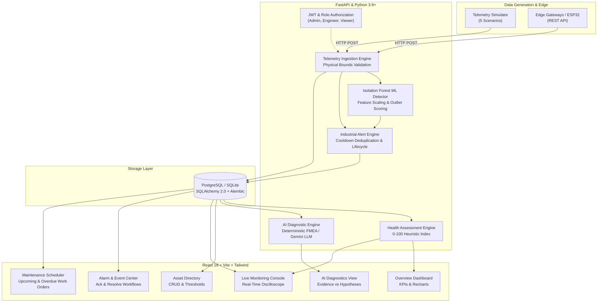

# IntelliMaintain — AI-Powered Industrial Predictive Maintenance Platform

[](https://github.com/nipun-pandey/intellimaintain/actions/workflows/ci.yml)
[](https://opensource.org/licenses/MIT)
[](https://www.python.org/)
[](https://reactjs.org/)
[](https://fastapi.tiangolo.com/)

> **Intelligent Equipment Monitoring & Predictive Maintenance.**  
> Monitor industrial assets, analyze telemetry trends, detect multivariate anomalies with machine learning, prevent downtime with intelligent alerts, and execute evidence-based AI diagnostics.

---

## 1. Problem Statement & Overview

Industrial equipment (such as centrifugal cooling water pumps, high-pressure rotary air compressors, large induction drive motors, and induced draft cooling tower fans) generates high-frequency sensory telemetry. Subtle deviations in vibration, temperature, pressure, and motor current often signal early-stage degradation (e.g. bearing fatigue, impeller unbalance, cavitation, or shaft misalignment) long before catastrophic failure occurs.

However, diagnosing these multidimensional trends manually across large fleets is challenging and error-prone. **IntelliMaintain** solves this by providing:
1. **Telemetry Streaming & Ingestion:** Ingestion API supporting single readings and batches with physical validation.
2. **Multivariate Anomaly Detection:** Real-time outlier detection using scikit-learn's Isolation Forest algorithm.
3. **Smart Alert Engine:** Configurable threshold alarms, rate-of-change jump detection, and cooldown deduplication.
4. **Heuristic Health Assessment:** Explainable 0–100 equipment health scoring based on alarm history, threshold headroom, and signal freshness.
5. **Evidence-Based AI Diagnostics:** Deterministic Failure Modes and Effects Analysis (FMEA) expert engine with optional Google Gemini LLM reasoning.
6. **Telemetry Simulator:** 5 built-in operational scenarios without requiring physical edge sensors.

---

## 2. System Architecture



---

## 3. Technology Stack

### Backend
- **Framework:** FastAPI (Python 3.9+) with asynchronous route handling
- **Data Validation:** Pydantic V2 & Pydantic-Settings
- **ORM & Migrations:** SQLAlchemy 2.0 & Alembic
- **Primary Database:** PostgreSQL 15+ (with native SQLite support for local dev & testing)
- **Machine Learning & Data Science:** scikit-learn (Isolation Forest), NumPy, Pandas
- **Security:** Passlib (Bcrypt) & Python-Jose (JWT tokens)
- **Testing:** Pytest, pytest-asyncio, HTTPX

### Frontend
- **Library:** React 18 with TypeScript
- **Tooling & Bundler:** Vite
- **Styling:** Tailwind CSS (Dark charcoal/navy sidebar, slate workspace)
- **Data Visualization:** Recharts (Area charts, Line trends, Donut distribution)
- **Icons:** Lucide React
- **Client Routing:** React Router v6
- **HTTP Client:** Axios with JWT request/response interceptors

### DevOps & CI/CD
- **Containerization:** Multi-stage Dockerfiles for backend and frontend
- **Orchestration:** Docker Compose with PostgreSQL health checks
- **CI/CD:** GitHub Actions automated test, lint, and build pipeline

---

## 4. User Interface Navigation

The interface resembles a modern industrial SCADA / APM operations console:

1. **Overview Dashboard (`/`):** Real-time fleet reliability summary, at-risk asset counters, sensor trend graphs, condition distribution, and latest alarms.
2. **Equipment Directory (`/equipment`):** Asset inventory, search, type/status filters, addition modal, and health ratings.
3. **Equipment Details (`/equipment/:id`):** Deep telemetry inspection, health breakdown with penalty deductions, active alarms, and maintenance logs.
4. **Live Monitoring (`/monitoring`):** Real-time sensor oscilloscope (Temperature, Vibration, Pressure, Current, RPM) with live streaming and scenario injection.
5. **Alarms & Anomalies (`/alerts`):** Multidimensional alarm feed (Thresholds vs ML Anomalies), Acknowledge action, and Resolve modal.
6. **Maintenance (`/maintenance`):** Work order scheduling, overdue servicing alerts, and technician sign-off.
7. **Analytics (`/analytics`):** Historical 1h/6h/24h/7d downsampled telemetry aggregations and wear trends.
8. **AI Diagnostics (`/diagnostics`):** Grounded diagnostic assistant presenting verified physical evidence, FMEA hypotheses, suggested inspections, and recommended actions.
9. **Settings (`/settings`):** System status, simulation controls, and development credentials reference.

---

## 5. Machine Learning Methodology & Actual Results

### Algorithm: Multivariate Isolation Forest
The anomaly detector isolates outliers by building random binary trees over 5 normalized physical dimensions:
- Bearing Temperature (°C)
- RMS Vibration Velocity (mm/s)
- Operating Pressure (bar)
- Motor Current (A)
- Rotational Shaft Speed (RPM)

### Benchmark Evaluation Results (Computed via `evaluate_model.py`)
Tested against a synthetic industrial benchmark containing 1,000 normal cycles and 100 mechanical failure patterns (bearing degradation, cavitation, thermal runaway):

| Metric | Result | Benchmark Context |
|---|---|---|
| **Test Set Size** | 1,100 Samples | 1,000 Normal / 100 Anomalous |
| **Precision** | **97.98%** (`0.9798`) | Minimal false alarm disruptions |
| **Recall** | **97.00%** (`0.9700`) | Captures 97 of 100 failure modes |
| **F1 Score** | **97.49%** (`0.9749`) | Balanced harmonic performance |
| **Confusion Matrix** | **TN=998, FP=2, FN=3, TP=97** | Highly stable separation |

*Note: The calculated anomaly score is an outlier distance metric in feature space, NOT a calibrated probability of failure. Physical root-cause validation by reliability engineers is always required.*

---

## 6. Telemetry Simulator: 5 Industrial Scenarios

The simulator allows full platform verification without external hardware:

1. **Normal Operation:** Emits stable sensor readings within plausible OEM design envelopes.
2. **Gradual Deterioration:** Gradually amplifies vibration from 2.2 to 8.5 mm/s and ramps temperature over 30 steps to simulate progressive bearing wear.
3. **Sudden Anomaly:** Injects an immediate severe shock spike exceeding ISO Zone D thresholds after step 3.
4. **Sensor Failure:** Freezes sensor readings to a fixed value and tags telemetry quality as `bad`.
5. **Communication Interruption:** Pauses transmission after one step to verify stale telemetry detection and alarm triggering.

---

## 7. Setup & Execution Instructions

### Prerequisites
- Python 3.9+ installed
- Node.js 18+ and npm installed
- Git installed
- *(Optional)* Docker & Docker Compose

---

### Option A: Local Development Workflow (Fastest)

#### 1. Clone Repository & Setup Backend
```bash
# Clone the repository
git clone https://github.com/nipun-pandey/intellimaintain.git
cd intellimaintain

# Create Python virtual environment
python3 -m venv .venv
source .venv/bin/activate

# Install backend dependencies
pip install -r backend/requirements.txt

# Run migrations and seed demonstration data
cd backend
python -m app.seeds.seed_data

# Start FastAPI backend server (Runs on http://localhost:8000)
uvicorn app.main:app --host 0.0.0.0 --port 8000 --reload
```

#### 2. Setup & Start Frontend
In a new terminal window:
```bash
cd frontend

# Install dependencies
npm install

# Start Vite development server (Runs on http://localhost:3000)
npm run dev
```

Open [http://localhost:3000](http://localhost:3000) in your browser.

---

### Option B: Docker Compose Workflow

If Docker is installed on your system:
```bash
# Copy example environment configuration
cp .env.example .env

# Build and launch PostgreSQL, Backend, and Frontend containers
docker-compose up --build
```
- Frontend: [http://localhost:3000](http://localhost:3000)
- Backend API Docs: [http://localhost:8000/docs](http://localhost:8000/docs)
- Health Probe: [http://localhost:8000/health](http://localhost:8000/health)

---

## 8. Demo User Credentials

The database comes pre-seeded with 3 development accounts covering role-based access control:

| Role | Email Address | Password | Permissions |
|---|---|---|---|
| **Admin** | `admin@intellimaintain.io` | `AdminPass123!` | Full control (Asset creation, archiving, simulation) |
| **Engineer** | `engineer@intellimaintain.io` | `EngineerPass123!` | Operations (Acknowledge/Resolve alarms, Work orders) |
| **Viewer** | `viewer@intellimaintain.io` | `ViewerPass123!` | Read-only dashboards and telemetry monitoring |

*(The login screen also provides convenient one-click demo login buttons.)*

---

## 9. Testing & Quality Verification

### Run Backend Automated Tests
All 30 backend tests run against an isolated in-memory test database:
```bash
cd backend
source ../.venv/bin/activate
PYTHONPATH=. pytest -v
```
**Result:** `30 passed in ~31s`

### Run Machine Learning Evaluation
```bash
cd backend
source ../.venv/bin/activate
python -m app.ml.evaluate_model
```

### Run Frontend Type-Check & Build
```bash
cd frontend
npm run lint
npm run build
```
**Result:** ESLint clean (0 errors, 0 warnings), `tsc && vite build` built in 1.98s.

---

## 10. API Documentation Summary

| Method | Endpoint | Description | Auth Required |
|---|---|---|---|
| `GET` | `/health` | System liveness probe & DB connection status | No |
| `POST` | `/api/v1/auth/login` | Authenticate user & issue JWT token | No |
| `POST` | `/api/v1/auth/register` | Register new user account | No |
| `GET` | `/api/v1/auth/me` | Fetch authenticated user profile | Yes |
| `GET` | `/api/v1/equipment` | List equipment with search & filters | Yes |
| `POST` | `/api/v1/equipment` | Create equipment asset | Engineer/Admin |
| `GET` | `/api/v1/equipment/{id}` | Get equipment metadata & health index | Yes |
| `POST` | `/api/v1/telemetry/ingest` | Ingest single telemetry reading | Yes |
| `POST` | `/api/v1/telemetry/batch` | Ingest batch edge telemetry | Yes |
| `GET` | `/api/v1/telemetry/equipment/{id}/recent` | Get latest telemetry for live monitoring | Yes |
| `GET` | `/api/v1/telemetry/equipment/{id}/aggregate`| Get downsampled trend points (1h/6h/24h/7d) | Yes |
| `GET` | `/api/v1/alerts` | Query active alarms with filters | Yes |
| `POST` | `/api/v1/alerts/{id}/acknowledge` | Transition alarm to Acknowledged | Engineer/Admin |
| `POST` | `/api/v1/alerts/{id}/resolve` | Resolve alarm with corrective notes | Engineer/Admin |
| `GET` | `/api/v1/maintenance` | Query work orders (overdue/upcoming) | Yes |
| `POST` | `/api/v1/maintenance` | Schedule new maintenance work order | Engineer/Admin |
| `POST` | `/api/v1/maintenance/{id}/complete` | Mark maintenance completed with notes | Engineer/Admin |
| `GET` | `/api/v1/analytics/dashboard` | Aggregated fleet KPIs & distribution | Yes |
| `GET` | `/api/v1/diagnostics/equipment/{id}` | Generate evidence-based diagnostic report | Yes |
| `GET` | `/api/v1/simulator/status` | Read simulator operational status | Yes |
| `POST` | `/api/v1/simulator/start` | Start telemetry scenario | Engineer/Admin |
| `POST` | `/api/v1/simulator/stop` | Halt simulation | Engineer/Admin |

Interactive Swagger documentation is available at `/docs` when the backend is running.

---

## 11. Security Considerations

- **Secret Key Isolation:** JWT signing keys are loaded strictly from environment variables (`.env`).
- **No Committed Secrets:** `.env` and SQLite database files are excluded from Git via `.gitignore`.
- **Role-Based Guards:** Endpoints enforce strict roles (`admin`, `engineer`, `viewer`).
- **Input Validation:** Pydantic validators guard against physical out-of-range anomalies and invalid types.

---

## 12. Known Limitations & Future Improvements

- **Remaining Useful Life (RUL):** IntelliMaintain estimates multi-factor condition health indices. Calibrated Remaining Useful Life (RUL) estimation requires run-to-failure historical sensor datasets (such as NASA C-MAPSS or PRONOSTIA) which are planned for future releases.
- **Physical Protocols:** Future releases will support direct edge ingestion via MQTT brokers, Modbus TCP/IP, and OPC-UA.

---

## 13. License

This project is licensed under the MIT License — see the [LICENSE](LICENSE) file for details.
