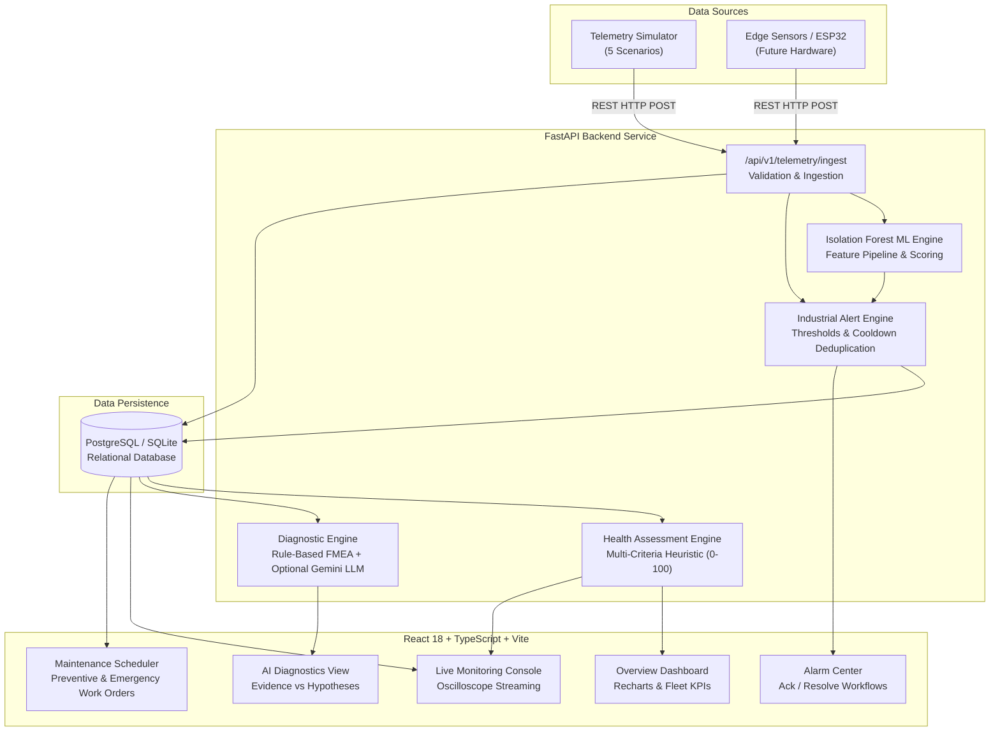

# IntelliMaintain — Technical Architecture & Engineering Guide

## 1. System Overview

IntelliMaintain is an industrial-grade equipment monitoring and predictive maintenance platform designed to track real-time telemetry from industrial assets (e.g., centrifugal pumps, rotary compressors, induction motors, and cooling tower fans), detect multivariate operational anomalies, evaluate ISO 10816 vibration guidelines, and assist reliability engineers with actionable, evidence-based diagnostic recommendations.

---

## 2. Telemetry Pipeline & Physical Units

Each incoming reading is validated against physical bounds before persistence:

| Measurement | Physical Parameter | Engineering Unit | Validation Range | Standard / Reference |
|---|---|---|---|---|
| `temperature` | Bearing / Winding Temp | °C | [-50.0, 350.0] | OEM Thermal Limits |
| `vibration` | RMS Vibration Velocity | mm/s RMS | [0.0, 150.0] | ISO 10816 Vibration Zones |
| `pressure` | Operating Pressure | bar | [0.0, 100.0] | Fluid / Pneumatic Header |
| `motor_current` | Motor Phase Current | Amperes (A) | [0.0, 1000.0] | Full Load Amperes (FLA) |
| `speed_rpm` | Rotational Speed | RPM | [0.0, 10000.0] | Shaft Tachometer |
| `sensor_quality` | Signal Integrity | Enum | good, suspect, bad, offline | Telemetry Data Quality |

---

## 3. Machine Learning Anomaly Detection

### Algorithm: Scikit-Learn Isolation Forest
- **Unsupervised Ensemble:** 100 isolation isolation trees partitioning multivariate space.
- **Contamination Factor:** 0.08 (calibrated for industrial false-alarm avoidance).
- **Features Extracted:** `[temperature, vibration, pressure, motor_current, speed_rpm]`.
- **Z-Score Feature Explainability:** When an anomaly is detected, the detector computes standard deviation deviations ($\sigma$) against baseline means to explain which physical variables contributed most to the anomaly.

### Model Evaluation Results (from `app.ml.evaluate_model`)
Evaluation performed on a labeled synthetic industrial dataset of 1,100 samples (1,000 normal baseline cycles, 100 bearing wear / cavitation / thermal runaway anomalies):
- **Precision:** 0.9798
- **Recall:** 0.9700
- **F1 Score:** 0.9749
- **Confusion Matrix:** True Negatives: 998, False Positives: 2, False Negatives: 3, True Positives: 97.

*Note: Outlier scores reflect distance from the learned normal operating envelope, NOT a calibrated mathematical probability of equipment breakdown.*

---

## 4. Alert Engine & Cooldown Deduplication

Alert storms can overwhelm operators during an industrial incident. To solve this, the `AlertEngine` enforces **temporal deduplication**:
- **Cooldown Key:** Formatted as `eq-{id}:{metric}:{severity}`.
- **Cooldown Interval:** Configurable (default 300 seconds).
- **Suppression:** If an unresolved or recent alert with the identical cooldown key exists within the cooldown window, subsequent duplicate alerts are suppressed.
- **State Lifecycle:** `open` $\rightarrow$ `acknowledged` (assigned engineer logs review) $\rightarrow$ `resolved` (requires mandatory corrective notes).

---

## 5. Equipment Health Scoring Methodology

Equipment health is evaluated as an explainable heuristic index (0 to 100):
- **Starting Score:** 100.0 (Nominal baseline).
- **Critical Alarm Penalty:** -25.0 to -40.0 pts.
- **High Alarm Penalty:** -12.0 to -25.0 pts.
- **Threshold Headroom Penalty:** -10.0 to -15.0 pts for temperature/vibration exceedances.
- **ML Anomaly Density:** -10.0 to -20.0 pts if $\ge 20\%$ of recent readings are anomalous.
- **Telemetry Latency / Freshness:**
  - $0 - 15$ minutes: Fresh (0 pt deduction).
  - $15 - 60$ minutes: Delayed (-15 pts deduction, status "Stale").
  - $> 60$ minutes: Offline (-35 pts deduction, category "Stale / Inconclusive").

---

## 6. AI Diagnostic Engine: Rule-Based Fallback vs LLM

To ensure high availability in air-gapped industrial plants, IntelliMaintain operates with a dual diagnostic architecture:
1. **Deterministic Rule-Based Expert System (Default):**
   - Applies grounded Failure Modes and Effects Analysis (FMEA) trees.
   - Evaluates combinations of high vibration, temperature, current, and pressure drops.
   - Formulates concrete inspection steps (laser alignment, FFT vibration spectrum, megger insulation test).
2. **Gemini Industrial LLM (Optional):**
   - Activated when `GEMINI_API_KEY` is provided in environment variables.
   - Receives actual measured evidence JSON and generates contextualized synthesis.
   - Strictly separates empirical facts from hypotheses and includes uncertainty disclaimers.

---

## 7. Authentication & Role-Based Authorization

- **JWT Tokens:** Signed using HMAC-SHA256 with 24-hour expiration.
- **Password Hashing:** Passlib with bcrypt.
- **Roles:**
  - **Admin:** Full rights (Asset registration, editing, archiving, simulator execution, alert resolution).
  - **Engineer:** Operational rights (Telemetry ingestion, alert acknowledgment, alert resolution, maintenance creation, simulator execution).
  - **Viewer:** Read-only access to dashboards, live telemetry, and reports.
